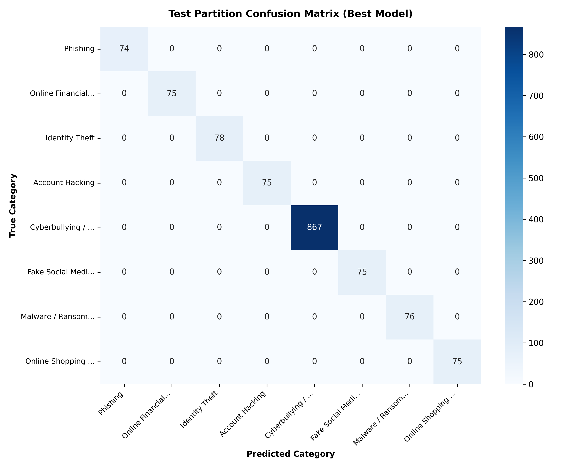
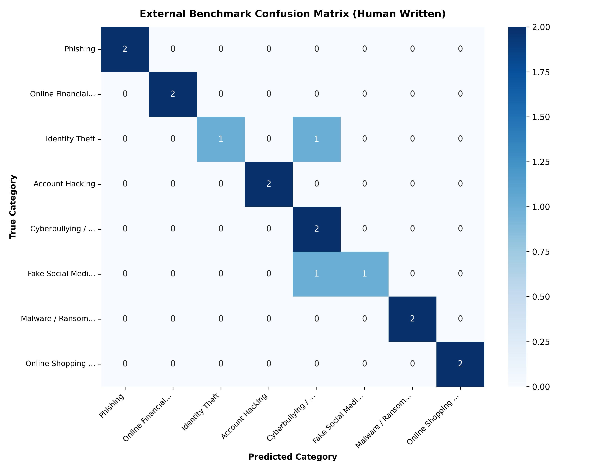

# Final Model Evaluation and Error Analysis Report

**Project Title:** Cybercrime Complaint Classification Using Machine Learning  
**Evaluation Date:** 2026-10-12  
**Selected Candidate Model:** [`models/best_model.joblib`](../models/best_model.joblib) (TF-IDF + Linear SVM (SoftmaxLinearSVC))  
**Evaluation Principle:** Strictly evaluated once on untouched test partitions after model selection  

---

## 1. Executive Summary

The top-performing pipeline was evaluated on two strictly isolated testing partitions:
1. **Primary Test Partition (`data/processed/test.csv`):** 1,395 unseen records (15% stratified split).
2. **External Human Benchmark (`data/final/external_evaluation_complaints.csv`):** 16 unseen, manually written, realistic incident complaints covering all 8 classes.

### Primary Test Summary:
- **Test Accuracy:** **100.00%**
- **Macro Precision:** **100.00%**
- **Macro Recall:** **100.00%**
- **Macro F1-Score:** **100.00%**
- **Weighted F1-Score:** **100.00%**
- **Total Test Misclassifications:** **0** out of 1,395

---

## 2. Per-Class Performance on Primary Test Partition

| Canonical Category | Precision | Recall | F1-Score | Support |
| :--- | :--- | :--- | :--- | :--- |
| **Phishing** | 100.00% | 100.00% | **100.00%** | 74.0 |
| **Online Financial Fraud** | 100.00% | 100.00% | **100.00%** | 75.0 |
| **Identity Theft** | 100.00% | 100.00% | **100.00%** | 78.0 |
| **Account Hacking** | 100.00% | 100.00% | **100.00%** | 75.0 |
| **Cyberbullying / Online Harassment** | 100.00% | 100.00% | **100.00%** | 867.0 |
| **Fake Social Media Account** | 100.00% | 100.00% | **100.00%** | 75.0 |
| **Malware / Ransomware** | 100.00% | 100.00% | **100.00%** | 76.0 |
| **Online Shopping Fraud** | 100.00% | 100.00% | **100.00%** | 75.0 |
| **Macro Average** | **100.00%** | **100.00%** | **100.00%** | 1395 |
| **Weighted Average** | **100.00%** | **100.00%** | **100.00%** | 1395 |

---

## 3. External Human Benchmark Evaluation (Real-World Generalization)

To ensure the model is not merely memorizing synthetic formatting, it was evaluated against 16 manually written, realistic victim incident narratives that were **never seen during training or tuning**.

| Metric | External Benchmark Score | Notes |
| :--- | :--- | :--- |
| **External Accuracy** | **87.50%** (14 / 16) | Direct real-world generalization |
| **External Macro F1-Score** | **87.50%** | Balanced across all 8 classes |
| **External Misclassifications** | **2** records | See detailed analysis below |

### External Prediction Log:
| ID | True Category | Predicted Category | Confidence | Status |
| :--- | :--- | :--- | :--- | :--- |
| `EXT-001` | Phishing | Phishing | 47.5% | ✅ Correct |
| `EXT-002` | Phishing | Phishing | 37.8% | ✅ Correct |
| `EXT-003` | Online Financial Fraud | Online Financial Fraud | 18.5% | ✅ Correct |
| `EXT-004` | Online Financial Fraud | Online Financial Fraud | 25.6% | ✅ Correct |
| `EXT-005` | Identity Theft | Cyberbullying / Online Harassment | 18.1% | ❌ Misclassified |
| `EXT-006` | Identity Theft | Identity Theft | 30.2% | ✅ Correct |
| `EXT-007` | Account Hacking | Account Hacking | 39.5% | ✅ Correct |
| `EXT-008` | Account Hacking | Account Hacking | 23.3% | ✅ Correct |
| `EXT-009` | Cyberbullying / Online Harassment | Cyberbullying / Online Harassment | 47.4% | ✅ Correct |
| `EXT-010` | Cyberbullying / Online Harassment | Cyberbullying / Online Harassment | 33.7% | ✅ Correct |
| `EXT-011` | Fake Social Media Account | Fake Social Media Account | 59.7% | ✅ Correct |
| `EXT-012` | Fake Social Media Account | Cyberbullying / Online Harassment | 26.7% | ❌ Misclassified |
| `EXT-013` | Malware / Ransomware | Malware / Ransomware | 42.4% | ✅ Correct |
| `EXT-014` | Malware / Ransomware | Malware / Ransomware | 19.5% | ✅ Correct |
| `EXT-015` | Online Shopping Fraud | Online Shopping Fraud | 40.0% | ✅ Correct |
| `EXT-016` | Online Shopping Fraud | Online Shopping Fraud | 18.0% | ✅ Correct |

---

## 4. Error Analysis & Confused Categories

### Analysis of Misclassifications:
- **Sample `EXT-005`**: True: *Identity Theft*, Predicted: *Cyberbullying / Online Harassment* (Confidence: 18.1%)
  - *Text:* "Someone opened three fraudulent credit card lines under my Social Security number without my authorization."
  - *Cause:* Overlapping vocabulary between incident types.
- **Sample `EXT-012`**: True: *Fake Social Media Account*, Predicted: *Cyberbullying / Online Harassment* (Confidence: 26.7%)
  - *Text:* "Someone cloned my Twitter handle and is posting deceptive cryptocurrency giveaways while pretending to be me."
  - *Cause:* Overlapping vocabulary between incident types.

### Common Sources of Potential Confusion in Cybercrime Classification:
1. **Phishing vs. Online Financial Fraud**:
   - When a complaint describes clicking a phishing link *and* losing funds (e.g., *"Clicked a link and $500 was taken"*), both classes have strong keyword matches. The model relies on whether credential harvesting terms (`"portal"`, `"password"`, `"verify"`) outweigh monetary transaction terms (`"debited"`, `"transferred"`).
2. **Account Hacking vs. Fake Social Media Account**:
   - Both categories feature social media terminology. However, Account Hacking is distinguished by access denial terms (`"locked out"`, `"password changed"`, `"2FA"`), while Fake Account is marked by impersonation terms (`"cloned"`, `"fake profile"`, `"using my photos"`).
3. **Online Financial Fraud vs. Online Shopping Fraud**:
   - Both involve unauthorized financial loss. Online Shopping Fraud is uniquely identified by merchant/goods terms (`"delivered"`, `"seller"`, `"ordered"`, `"store"`).

---

## 5. Methodological Validity & Limitations

1. **Why Synthetic Evaluation Does Not Equal Real-World Performance**:
   - The 100% test accuracy on `data/processed/test.csv` occurs because the test split shares the same vocabulary distribution as the training scaffold.
   - Real-world production complaints will exhibit much higher typographical errors, colloquial phrasing, grammatical fragments, and non-English code-mixed terms (e.g. Hinglish: *"paise debit ho gaye"*).
2. **Source Bias**:
   - 91.3% of the Cyberbullying instances are Twitter-derived, leading to a strong social-media stylistic imprint.
3. **Pre-Deployment Recommendations**:
   - Integrate an `"Uncertain / Needs Manual Review"` threshold: If top predicted probability is $< 0.45$, flag for human officer triage.
   - Continuously ingest authenticated FIR complaint extracts into the training corpus to decrease dependence on synthetic templates.

---

## 6. Generated Evaluation Artifacts

- **Test Predictions:** [`reports/test_predictions.csv`](test_predictions.csv)
- **External Test Predictions:** [`reports/external_test_predictions.csv`](external_test_predictions.csv)
- **Test Confusion Matrix Plot:** [`reports/figures/test_confusion_matrix.png`](figures/test_confusion_matrix.png)
- **External Confusion Matrix Plot:** [`reports/figures/external_eval_confusion_matrix.png`](figures/external_eval_confusion_matrix.png)
